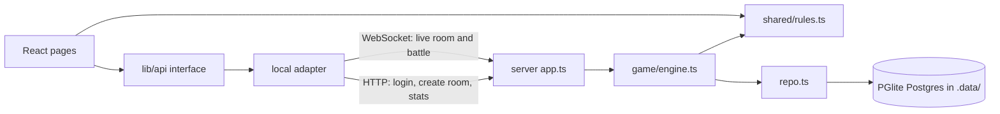
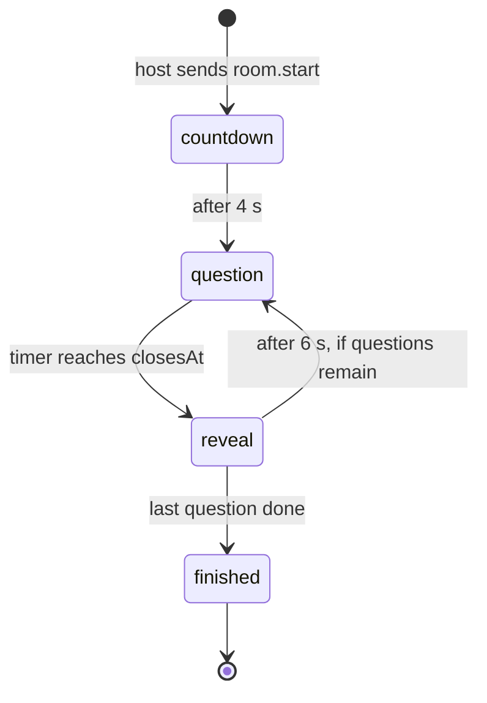
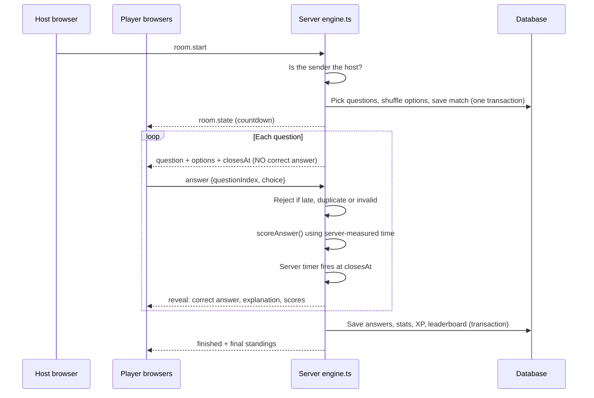
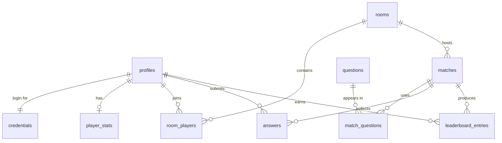

# MYTHOS — Learning Guide

A study guide to how MYTHOS is built and why. Read it top to bottom once, then use the
"Where to look" pointers to open the real code alongside each section.

---

## 1. What the app is

MYTHOS is a real-time multiplayer quiz battle. Players create or join rooms, the host picks
categories and settings, and everyone answers the same timed questions. A server decides the
timing, checks answers and calculates scores, so no player can cheat from their browser.

Right now it runs fully locally: a Node game server with an embedded Postgres database
(PGlite) and a React frontend. A Supabase schema is prepared for a future cloud version.

---

## 2. Tech stack and why each piece was chosen

| Layer | Tool | Why |
|---|---|---|
| UI framework | React 18 + TypeScript | Component model, strong typing shared with the server |
| Build tool | Vite 5 | Fast dev server, simple production build |
| Routing | React Router 6 | One URL per screen (`/hub`, `/room/:id`, ...) |
| Styling | Tailwind CSS 3 | Utility classes; custom theme colours (purple, electric blue, gold) |
| Server runtime | Node.js run through `tsx` | Runs TypeScript directly, no separate compile step |
| Realtime | `ws` (WebSockets) | Two-way, low-latency messages for lobby and battle |
| Database | PGlite (`@electric-sql/pglite`) | Real Postgres compiled to WebAssembly; no Docker needed |
| Security | `node:crypto` | scrypt password hashing, HMAC-signed session tokens |
| Tests | Vitest | Unit tests and multi-client integration tests |
| Lint | ESLint + `typescript-eslint` | Catches bugs and React hook mistakes |
| Dev orchestration | `concurrently` | `npm run dev` starts server and frontend together |

---

## 3. Folder map

```
mythos/
├─ src/                  React frontend
│  ├─ pages/             One file per screen
│  │  └─ room/           WaitingLobby → Arena → Results
│  ├─ components/        Reusable UI (Avatar, PlayerBoard, EnergyField, ...)
│  ├─ hooks/             useRealtime (WebSocket state), useJoin
│  ├─ state/             auth and toast React contexts
│  └─ lib/api/           Backend interface: types.ts + local.ts adapter
├─ shared/               Code used by BOTH browser and server
│  ├─ rules.ts           Scoring, XP, room codes, validation, clock maths
│  └─ protocol.ts        Message types sent over the WebSocket
├─ server/
│  ├─ db/schema.sql      Local database tables
│  └─ src/
│     ├─ index.ts        Entry point
│     ├─ app.ts          HTTP routes + WebSocket handling
│     ├─ auth.ts         Password hashing and tokens
│     ├─ game/engine.ts  Rooms, matchmaking and the match lifecycle
│     ├─ repo.ts         SQL queries
│     ├─ db.ts           PGlite setup and seed loading
│     ├─ rateLimit.ts    Request throttling
│     └─ config.ts       Ports, timings, limits
├─ seed/                 Question bank (1,265 questions)
│  ├─ questions/         Hand-written, one file per category
│  ├─ generated/         Built by `npm run questions:generate`
│  ├─ imported/          Created by `npm run questions:import`
│  └─ data/              Countries and elements datasets for the generator
├─ supabase/             Cloud schema with Row Level Security (future path)
├─ tests/                Multiplayer and Supabase security tests
└─ scripts/              Bot players, Supabase seed generator
```

---

## 4. Big picture: how a request flows



- **HTTP** is used for one-off actions: sign up, log in, create a room, fetch stats,
  leaderboards and history.
- **WebSocket** is used for everything live: lobby list updates, who is in the room,
  questions, reveals and the scoreboard.

**Key idea — the API layer.** Pages never call `fetch` or open sockets directly. They call
functions defined in `src/lib/api/types.ts`. Today `local.ts` implements them. A future
`supabase.ts` can implement the same interface, and no page needs to change.

---

## 5. The match lifecycle (the heart of the game)

A match moves through four phases, defined in `shared/protocol.ts`:



One round in detail:



Default timings (`server/src/config.ts`):

| Setting | Value |
|---|---|
| Countdown before question 1 | 4 s |
| Reveal screen | 6 s |
| Grace period for network delay after `closesAt` | 300 ms |
| Host keeps host rights after disconnecting | 10 s |
| Disconnected player dropped from a lobby | 60 s |
| Empty room closed | 2 min |
| Idle lobby room closed | 30 min |

Game setting limits (`shared/rules.ts`, `DEFAULT_LIMITS`): 10–15 questions, 10–30 second
timer (default 20), 2–20 players.

---

## 6. Scoring, XP and ranks

All in `shared/rules.ts`, and only ever executed on the server for real points.

- **Correct answer:** 100 points.
- **Speed bonus:** up to 50, scaled by how much time was left:
  `round(50 × (1 − responseMs / durationMs))`.
- **Streak bonus:** from the 2nd consecutive correct answer,
  `min(10 × (streak − 1), 50)`.
- **Wrong or no answer:** 0 points, streak resets.

**Worked example.** 20 s timer, answered correctly after 5 s, and it is the player's 3rd
correct answer in a row:

- base 100
- speed `round(50 × (1 − 5/20))` = 38
- streak `10 × (3 − 1)` = 20
- **total 158**

**XP per match:** `20 + floor(points / 10)`, plus 100 for winning a match with more than one
player.

**Level from XP:** `floor(sqrt(xp / 100)) + 1`. So level 2 needs 100 XP, level 3 needs 400,
level 4 needs 900.

**Rank tiers by level:** Initiate (1), Adept (3), Warrior (6), Champion (10), Mythic (15).

---

## 7. Fair play: how cheating is prevented

| Threat | Defence | Where |
|---|---|---|
| Faking a score | Browser never sends points, only `choice`. Server computes score | `engine.ts`, `rules.ts` |
| Reading the answer early | Options are shuffled per match; correct index stays on the server until reveal | `engine.ts`, `match_questions` table |
| Answering after time is up | Rejected if `now > closesAt + 300 ms` | `engine.ts` |
| Answering twice / changing answer | In-memory check recorded synchronously, plus database `on conflict do nothing` | `engine.ts` |
| Non-host starting or kicking | Every host action checks the sender's user id | `engine.ts` |
| Forged login token | Tokens are HMAC-SHA256 signed; signature checked on every connection | `auth.ts` |
| Stolen password database | Passwords stored only as scrypt hashes with random salt; compared with `timingSafeEqual` | `auth.ts` |
| Spamming requests | Rate limiter | `rateLimit.ts` |
| Bad input | Usernames, passwords, room names, settings and avatars validated | `rules.ts` |
| Silent socket | Unauthenticated WebSocket closed after 10 s | `app.ts` |

**Why the duplicate check works without locks.** Node runs JavaScript on one thread and
handles one message at a time. If the server records "this player answered" before any
`await`, a second answer arriving a millisecond later sees the record and is rejected. The
database unique constraint is a second safety net.

---

## 8. Keeping every player's timer in sync

The server sends absolute timestamps (`closesAt`), not "20 seconds left". Each browser then
needs to know how far its own clock is from the server's.

Every 10 seconds the client sends `ping { t }`; the server replies `pong { t, serverNow }`.
The client estimates the clock offset (`estimateClockOffset` in `rules.ts`) assuming the
network delay is equal both ways, and shows `closesAt − (localNow + offset)`.

The browser timer is display only. The server's own timer decides when a round closes, and
the speed bonus is measured from the server's open time to the server's receive time.

---

## 9. Reconnection and host disconnection

- **Client side (`src/lib/api/local.ts`):** when the socket drops, the status changes to
  `reconnecting` (or `offline` if the browser has no network) and it retries automatically.
  After reconnecting it re-authenticates with the stored token and re-subscribes to its room.
- **Server side (`engine.ts`):** closing a socket does not remove a player from the room.
  Rejoining simply re-attaches them and they receive the current `room.state`.
- **Host leaves:** the host keeps host rights for 10 s. After that, `migrateHost` hands them
  to another connected player. The match keeps running because the server, not the host's
  browser, owns the timers.
- **Server restarts:** live match timers exist only in server memory, so a restart can't
  resume a battle. On startup `recoverAfterRestart` in `db.ts` closes any unfinished matches
  cleanly instead of leaving them stuck.

---

## 10. Rooms and matchmaking

- **Room codes:** 6 characters from `ABCDEFGHJKLMNPQRSTUVWXYZ23456789`. Letters I and O and
  digits 0 and 1 are left out so codes are easy to read aloud.
- **Private rooms:** joined only by code.
- **Public rooms:** listed live in the browser through `lobby.subscribe` / `lobby.rooms`.
  Rooms that are full or already in battle can't be joined.
- **Quick play:** joins an open public room with space, or creates a new one if none fits.
- **Cleanup:** a timer every 5 s closes empty and idle rooms.

---

## 11. Database tables

Local schema in `server/db/schema.sql`; the cloud version in `supabase/migrations/`.



| Table | Purpose |
|---|---|
| `profiles` | Username, avatar, XP |
| `credentials` | Password hash (local only; Supabase Auth replaces it in the cloud) |
| `rooms` | Code, name, public/private, settings, status |
| `room_players` | Who is in which room; `left_at` for leavers |
| `questions` | Question bank: category, difficulty, options, correct index, explanation, tradition, `valid_as_of`, `source` (credit for imported questions) |
| `seed_state` | Fingerprint of the seed files last loaded, so unchanged files aren't reseeded |
| `matches` | One row per battle |
| `match_questions` | Questions in a match with their shuffled option order and correct index |
| `answers` | Every submitted answer with time taken and points |
| `player_stats` | Totals: matches, wins, accuracy, streaks, best score |
| `leaderboard_entries` | Points per player per match, used for daily / weekly / all-time rankings |

**Transactions** are used when starting a match (match + its questions saved together) and
when finishing one (answers, stats and leaderboard saved together). Either everything is
written or nothing is.

---

## 12. The frontend screens

| Route area | File | What it does |
|---|---|---|
| Landing | `pages/Landing.tsx` | Intro and call to action |
| Login / sign up | `pages/Auth.tsx` | Calls the auth API, stores the token |
| Hub | `pages/Hub.tsx` | Main lobby: quick play, create, join, browse |
| Create room | `pages/CreateRoom.tsx` | Settings form (categories, difficulty, timer, size) |
| Join room | `pages/JoinRoom.tsx` | Enter a 6-character code |
| Public rooms | `pages/PublicRooms.tsx` | Live list of open rooms |
| Waiting lobby | `pages/room/WaitingLobby.tsx` | Players, connection dots, host controls |
| Battle arena | `pages/room/Arena.tsx` | Question, timer, options, reveal, live board |
| Results | `pages/room/Results.tsx` | Winner, standings, XP gained |
| Leaderboard | `pages/Leaderboard.tsx` | Daily / weekly / all-time |
| Profile | `pages/Profile.tsx` | Stats, level, rank tier |
| History | `pages/History.tsx` | Past matches |
| Settings | `pages/Settings.tsx` | Local preferences such as sound |

`pages/room/RoomPage.tsx` picks which of WaitingLobby, Arena or Results to show based on the
room status and match phase it receives from the server.

---

## 13. Testing

`npm test` runs 59 Vitest tests:

- **`shared/rules.test.ts`:** scoring, streaks, XP, levels, room codes, validation.
- **`server/src/seed.test.ts`:** at least 100 valid, unique questions; every category has all
  three difficulties; correct options are intact and answer positions are spread out; every
  current-affairs question is dated. It also tests the loader on temporary folders: loading all
  three seed folders, rejecting duplicates across files, reporting bad files, and the fingerprint.
- **`tests/generators.test.ts`:** regenerating gives exactly the committed files, and every
  generated answer is rechecked independently against the dataset or by recomputing the maths.
- **`tests/importers.test.ts`:** CSV parsing (quotes, commas, newlines), Open Trivia DB entity
  decoding and category mapping, and rejection reasons, using fixtures in `tests/fixtures/`.
- **`tests/question-bank-db.test.ts`:** Mixed matches spread across all categories, difficulty
  fallbacks fill a match, and a second start skips reseeding.
- **`tests/multiplayer.test.ts`:** starts a real server with an in-memory database and drives
  several WebSocket clients through sign-up, joining, quick play, host hand-over, a full
  4-player match with simultaneous / duplicate / late answers, reconnection, scoring checks,
  leaderboards and rate limiting.
- **`tests/supabase-rls.test.ts`:** checks the Supabase security policies against a local
  Postgres.

`npm run check` runs lint, typecheck, the question bank check, tests and build in one go.

**Learning point:** the integration tests use fast timings and disabled rate limits through
`ServerConfig`. Making timings configurable is what makes a real-time system testable in
seconds instead of minutes.

---

## 14. Commands

| Command | What it does |
|---|---|
| `npm install` | Install dependencies |
| `npm run dev` | Server on :3001 and Vite on :5173 (next free port if taken) |
| `npm start` | Build the frontend, then serve everything from :3001 (LAN play) |
| `npm run serve` | Serve an existing build without rebuilding |
| `npm test` | Run all tests |
| `npm run lint` / `npm run typecheck` | Code quality checks |
| `npm run check` | Lint + typecheck + test + build |
| `npm run bots -- <ROOMCODE> 3` | Add 3 bot players to a room |
| `npm run questions:check` | Validate the question bank and show counts |
| `npm run questions:generate` | Rebuild the generated geography, science and maths questions |
| `npm run questions:import -- --csv FILE --out seed/imported/NAME.json` | Import a CSV (or `--opentdb FILE`) |
| `npm run seed:supabase` | Generate the Supabase seed SQL from all seed files |

Environment variables for the server: `PORT` or `MYTHOS_PORT`, `MYTHOS_HOST`,
`MYTHOS_DATA_DIR`, `MYTHOS_MIN_PLAYERS`, `MYTHOS_CORS_ORIGINS`.

---

## 15. Key learnings

1. **Server-authoritative design.** Anything that affects fairness (time, answers, scores)
   must be decided by the server. The client only displays.
2. **Send timestamps, not durations.** Absolute end times plus a clock offset keep every
   screen in sync regardless of network delay.
3. **Hide secrets until they are needed.** The correct answer is not in the browser until the
   reveal, and option order is shuffled per match.
4. **Defence in depth.** Duplicate answers are blocked in memory and by a database
   constraint.
5. **State lives on the server, not the socket.** A dropped connection is not the same as
   leaving; this makes reconnection and host migration simple.
6. **Share the rules.** One `shared/rules.ts` used by client and server means scoring and
   validation never drift apart.
7. **Program to an interface.** The `lib/api` layer lets the backend be swapped (local today,
   Supabase later) without touching the UI.
8. **Use transactions for multi-row writes.** Starting and finishing a match are all-or-nothing.
9. **Make timings configurable.** Production uses human-friendly delays; tests use tiny ones.
10. **Know your hosting limits.** Vercel serverless functions can't keep WebSockets open, so a
    long-running server needs a host like Render, or a managed realtime service like Supabase
    Realtime.
11. **PGlite is a great local Postgres.** Real SQL, no Docker, and the schema carries over to
    Supabase with few changes.

---

## 16. Exercises to deepen your understanding

1. Change `SCORING.maxSpeedBonus` in `shared/rules.ts` to 80, run `npm test`, and read which
   tests fail and why.
2. Add a few questions to a file in `seed/questions/`, run `npm run questions:check`, and restart
   the server. `seedQuestions` in `server/src/db.ts` compares a fingerprint of the seed files with
   the one stored in the `seed_state` table, and only reseeds when they differ. It then upserts in
   batches (`on conflict (question) do update`), so new questions are added and edited ones updated
   without wiping `.data/`. Watch the server log for `question bank loaded`.
3. Open the browser DevTools Network tab, filter by WS, and watch the messages during a
   battle. Confirm that the correct answer only appears in the reveal message.
4. Start a room, add bots with `npm run bots`, then close the host tab mid-battle and watch
   the server log for host migration.
5. Read `answer` handling in `engine.ts` and trace exactly which checks a submission passes
   before being scored.

---

## 17. Where to go next

- `docs/DEPLOYMENT.md` — putting the game online (Render + Vercel, or the Supabase path).
- `supabase/migrations/` — compare the cloud schema and its Row Level Security policies with
  `server/db/schema.sql`.
